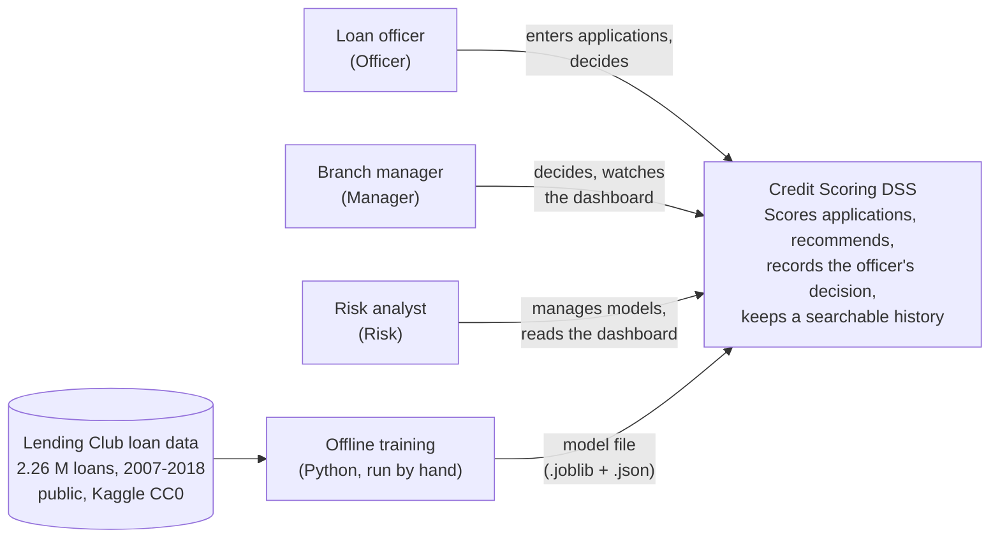

# 1. System context

Three kinds of bank staff use the system through a browser. The model is trained offline on public Lending Club loan data; the running system only reads the saved model file.

The system never connects to a credit bureau, core banking system or the internet at run time. Applicant data is typed in by the officer.
