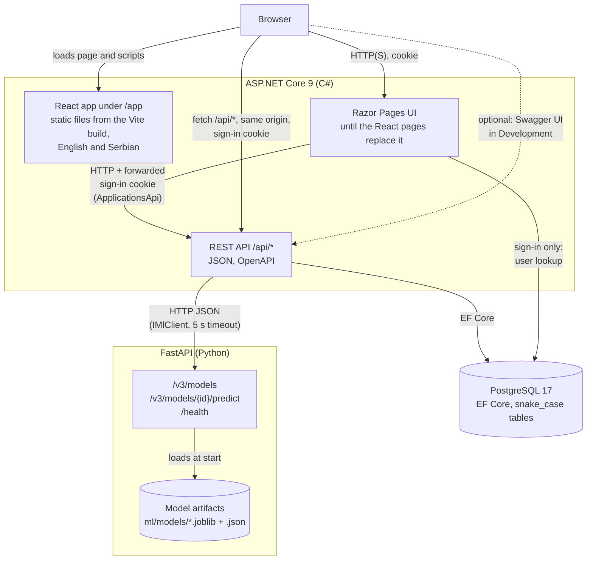
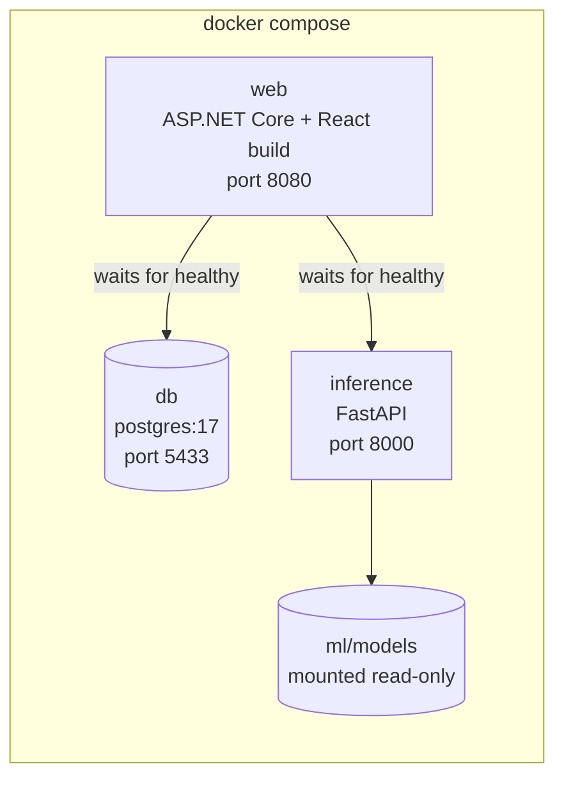

# 2. Containers and deployment

## Containers

Three running parts. The ASP.NET Core application owns all business rules and data and also serves the React app; the Python service only turns inputs into a probability and its top factors.

Why both UIs go through the API instead of calling services directly: there is one way in to the business rules, so the API and the UI cannot drift apart, and every rule is tested once. The React app runs in the browser and calls the API on the same origin, so the `HttpOnly`, `SameSite=Strict` cookie works without CORS and the SPA never sees a token.

## Deployment

`docker compose up --build` in the repository root starts all three on one machine. The web image builds the React app in a Node stage and copies it into `wwwroot/app`. Health checks make the web app wait until the database accepts connections and the inference service has a model loaded. In Development the web app migrates the database and seeds the demo users on start, so a fresh clone runs without manual steps. Running on a server is out of scope (supervisor, 2026-11-06).

For development the two services can also run directly (`dotnet run`, `uvicorn`) against the Compose database; see the root README.
