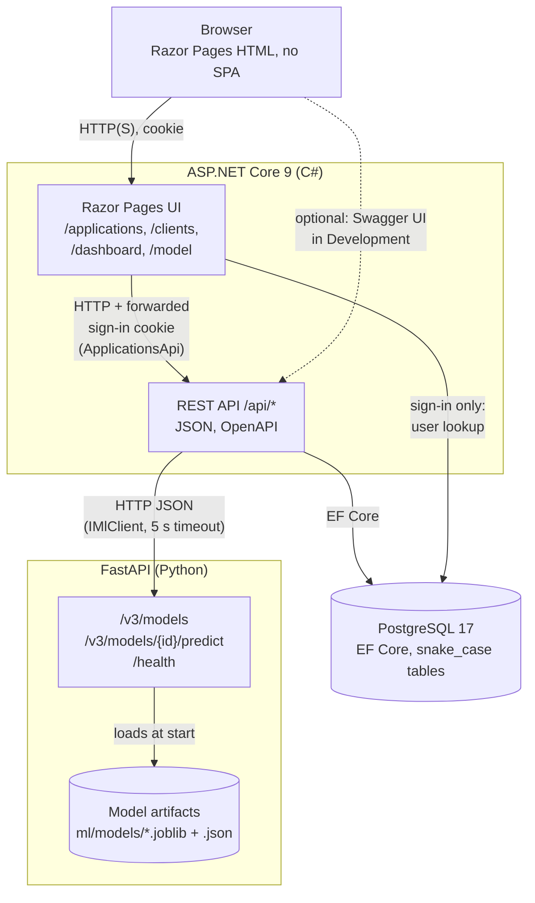
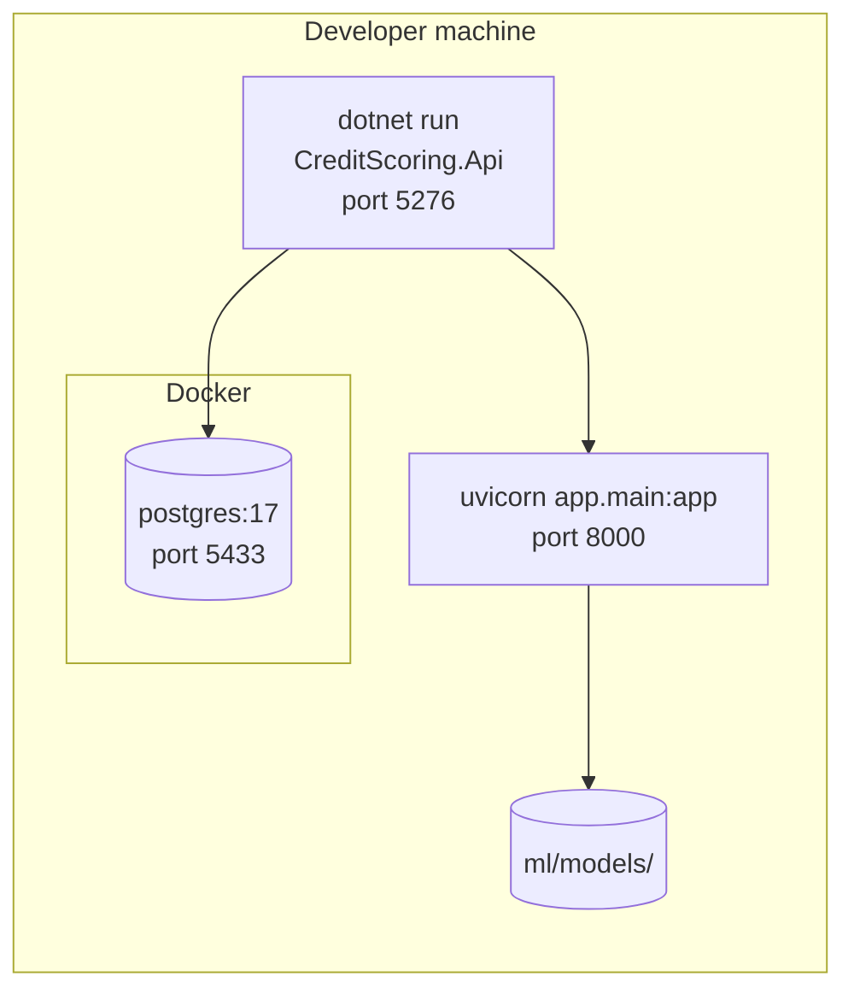
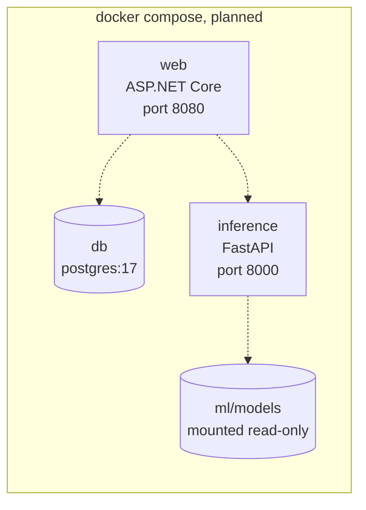

# 2. Containers and deployment

## Containers

Three running parts. The ASP.NET Core application owns all business rules and data; the Python service only turns inputs into a probability and its top factors.

Why the pages call the API over HTTP instead of calling services directly: there is one way in to the business rules, so the API and the UI cannot drift apart, and every rule is tested once.

## Deployment today

Everything runs on one developer machine. Only PostgreSQL runs in Docker.

## Deployment planned

One `docker compose up` starts all three, with health checks so the web app waits for its dependencies. Not built yet.

