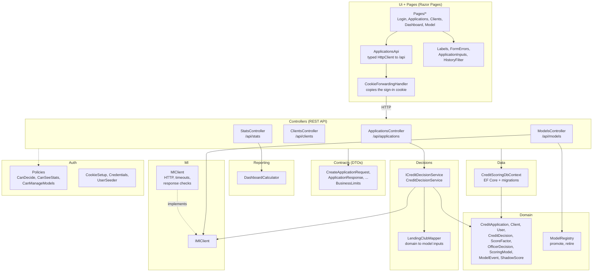

# 3. Backend components

Inside `backend/src/CreditScoring.Api`. Folders are layers: the UI and controllers depend on decisions and domain, never the other way round. The domain has no database or HTTP code.

## Who owns what

| Concern | Lives in | Not in |
|---|---|---|
| Input validation, business limits | `Contracts` (attributes, `BusinessLimits`) and controllers | Python |
| Recommendation rule (threshold, review band) | `ScoringModel.RecommendationFor`, called by `CreditDecisionService` | controllers, Python |
| When an officer must give a reason | `OfficerDecision.NeedsReason` | pages |
| Model roles (one active, shadows, retired) | `ModelRegistry` | database triggers |
| Turning inputs into a probability | Python inference service | C# |
| Who the user is | the sign-in cookie, read by `Credentials.ActorOf` | the request body |
