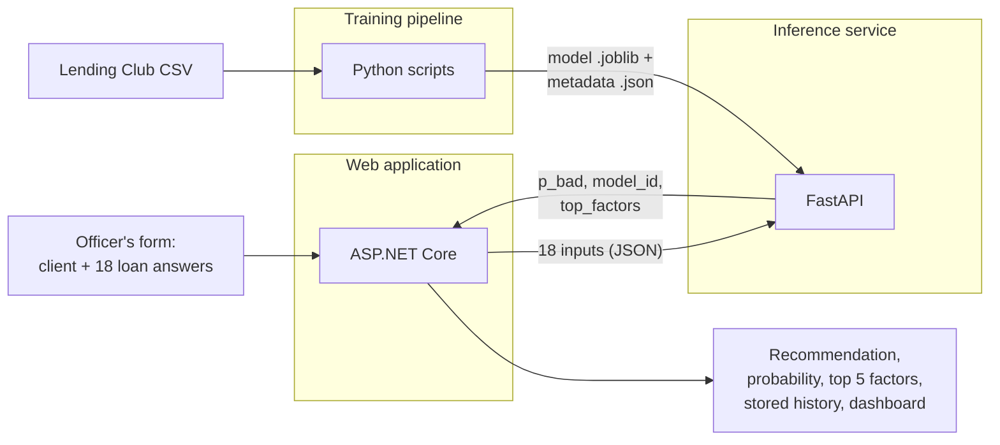

# 4. Black boxes

Each part seen only from outside: what goes in, what comes out, what it promises. Internals are in the other files.

## Web application

| In | Out | Promise |
|---|---|---|
| Sign-in (user name, password) | 8-hour cookie, `HttpOnly`, `SameSite=Strict` | The user's identity always comes from the cookie |
| New application: client id + 18 answers | `201` with the application, score and recommendation; or `400` with field errors | The application is stored even if scoring fails |
| Officer decision: approve or reject + reason | `200` with the recorded decision, or `400` if a reason is needed and missing | One decision per application, never changed afterwards |
| History query: name, dates, outcome, page | Page of summaries | Filters escape wildcards; dates are UTC |

REST endpoints (all need a signed-in user):

| Method | Path | Role |
|---|---|---|
| POST | `/api/applications` | Officer, Manager |
| GET | `/api/applications` | any |
| GET | `/api/applications/{id}` | any |
| POST | `/api/applications/{id}/rescore` | Officer, Manager |
| POST | `/api/applications/{id}/decision` | Officer, Manager |
| GET | `/api/applications/{id}/shadow-scores` | Manager, Risk |
| POST | `/api/clients` | Officer, Manager |
| GET | `/api/clients`, `/api/clients/{id}` | any |
| GET | `/api/models` | any |
| GET | `/api/models/available` | Risk |
| POST | `/api/models` | Risk |
| POST | `/api/models/{modelId}/promote`, `/retire` | Risk |
| GET | `/api/models/events` | Risk |
| GET | `/api/stats` | Manager, Risk |

## Inference service

| Method | Path | In | Out |
|---|---|---|---|
| GET | `/v3/models` | | every loaded Lending Club model: id, name, dataset, threshold, review band, created |
| POST | `/v3/models/{model_id}/predict` | 18 named inputs, missing allowed where the data had gaps | `p_bad` (0 to 1), `model_id`, `top_factors` (5, or `null`) |
| GET | `/health` | | `200` with the ids of all loaded models; `503` when the `/v1` default model (German Credit) is missing, even if the Lending Club model is loaded (known gap) |

`/v1` and `/v2` still serve the retired German Credit models. The exact contract is kept in the project's API contract document.

Promises: no state between calls, no business rules, an unknown model gives `404 model_not_found`, invalid input gives `422`, never a made-up score.

## Training pipeline

| In | Out | Promise |
|---|---|---|
| `accepted_2007_to_2018Q4.csv` (checked by SHA-256) | one artifact file + metadata (threshold, review band, library versions, data hash) | fixed seed 42; preprocessing is inside the saved pipeline, so serving uses exactly the training transforms |
