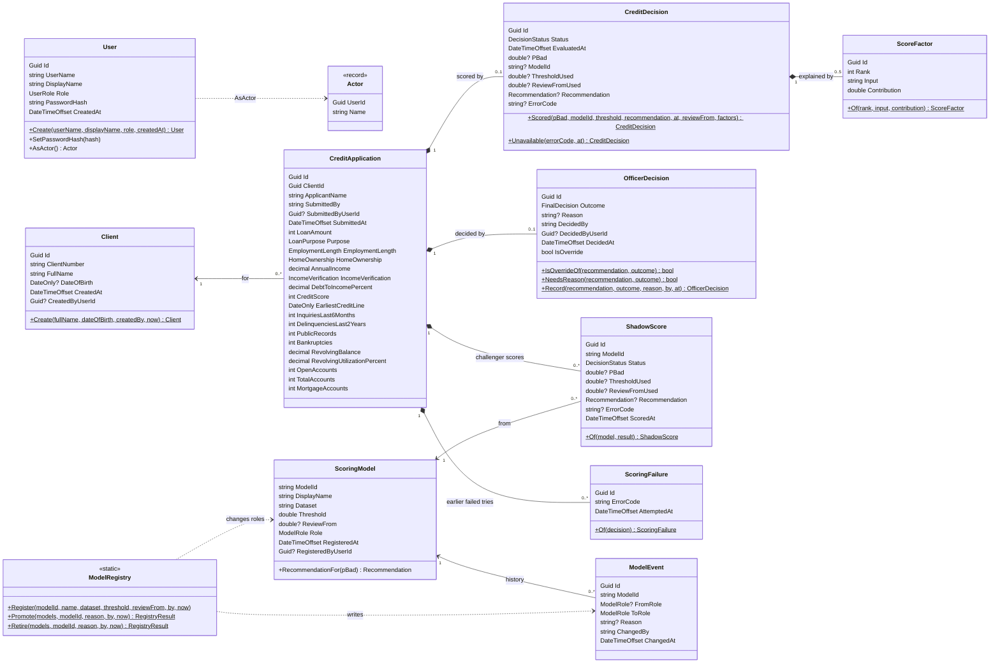

# 5. Domain classes

`backend/src/CreditScoring.Api/Domain`. Objects are created through factory methods (`Scored`, `Record`, `Of`, `Create`) that refuse invalid states, so an object that exists is valid.

## Enumerations

Stored in the database as their names.

| Enum | Values |
|---|---|
| `Recommendation` | Approve, Reject, Review |
| `FinalDecision` | Approve, Reject |
| `DecisionStatus` | Scored, ScoringUnavailable |
| `ModelRole` | Active, Shadow, Retired |
| `UserRole` | Officer, Manager, Risk |
| `LoanPurpose` | DebtConsolidation, CreditCard, HomeImprovement, MajorPurchase, Car, Medical, Moving, House, Vacation, Wedding, SmallBusiness, RenewableEnergy, Other |
| `EmploymentLength` | NotStated, LessThanOneYear, OneYear to NineYears, TenOrMoreYears |
| `HomeOwnership` | Rent, Own, Mortgage, Other |
| `IncomeVerification` | NotVerified, SourceVerified, Verified |

`SubmittedBy` and `DecidedBy` keep the person's name as it was at the time, next to the user id, so history still reads correctly if a user is renamed.
