# 5. Domain classes

`backend/src/CreditScoring.Api/Domain`. Objects are created through factory methods (`Scored`, `Record`, `Of`, `Create`) that refuse invalid states, so an object that exists is valid.

```mermaid
classDiagram
    direction LR

    class User {
        Guid Id
        string UserName
        string DisplayName
        UserRole Role
        string PasswordHash
        DateTimeOffset CreatedAt
        string PreferredLanguage
        int FailedSignInCount
        DateTimeOffset? LockedUntil
        DateTimeOffset? LastSignedInAt
        string? Email
        bool IsActive
        bool MustChangePassword
        Guid SecurityStamp
        Guid? BranchId
        +Create(userName, displayName, role, createdAt, branchId)$ User
        +NormalizeUserName(userName)$ string
        +SetPasswordHash(hash)
        +IsLockedOut(now) bool
        +RecordFailedSignIn(now)
        +RecordSignIn(now)
        +Edit(displayName, email, role, language, branchId)
        +SetPreferredLanguage(language)
        +Deactivate()
        +Reactivate()
        +ResetPassword(hash)
        +ChangePassword(hash)
        +AsActor() Actor
    }

    class UserAdministration {
        <<static>>
        +CheckBranch(role, branch)$ Refused?
        +Update(target, actingUserId, displayName, email, role, language, branch)$ ChangeResult
        +Deactivate(target, actingUserId)$ ChangeResult
        +Reactivate(target, branch)$ ChangeResult
    }

    class Branch {
        Guid Id
        string Code
        string Name
        string? City
        bool IsActive
        DateTimeOffset CreatedAt
        +Create(code, name, city, now)$ Branch
        +Edit(name, city)
        +Deactivate(hasActiveUsers) ChangeResult
        +Reactivate()
    }

    class ClientAnonymisation {
        <<static>>
        +Apply(client, applications, now)$ ChangeResult
    }

    class AuditEntry {
        Guid Id
        DateTimeOffset At
        Guid? UserId
        string? UserName
        AuditAction Action
        string Entity
        string EntityId
        string? TraceId
        string Changes
        +Record(at, by, action, entity, entityId, traceId, changes)$ AuditEntry
    }

    class Actor {
        <<record>>
        Guid UserId
        string Name
    }

    class Client {
        Guid Id
        string ClientNumber
        string FullName
        DateOnly? DateOfBirth
        string? Address
        string? Phone
        string? Email
        string? Employer
        Guid BranchId
        bool IsActive
        DateTimeOffset? AnonymisedAt
        DateTimeOffset CreatedAt
        Guid? CreatedByUserId
        +Create(fullName, dateOfBirth, branchId, createdBy, now, contact)$ Client
        +Edit(fullName, dateOfBirth, contact, now) ChangeResult
        +Deactivate() ChangeResult
        +Reactivate() ChangeResult
        +Anonymise(now) ChangeResult
    }

    class CreditApplication {
        Guid Id
        string Reference
        ApplicationStage Stage
        Guid? AssignedToUserId
        DateTimeOffset? WithdrawnAt
        string? WithdrawalReason
        Guid ClientId
        Guid BranchId
        string ApplicantName
        string SubmittedBy
        Guid? SubmittedByUserId
        DateTimeOffset SubmittedAt
        int LoanAmount
        LoanPurpose Purpose
        EmploymentLength EmploymentLength
        HomeOwnership HomeOwnership
        decimal AnnualIncome
        IncomeVerification IncomeVerification
        decimal DebtToIncomePercent
        int CreditScore
        DateOnly EarliestCreditLine
        int InquiriesLast6Months
        int DelinquenciesLast2Years
        int PublicRecords
        int Bankruptcies
        decimal RevolvingBalance
        decimal RevolvingUtilizationPercent
        int OpenAccounts
        int TotalAccounts
        int MortgageAccounts
        +AssignTo(user) ChangeResult
        +MayBeHandledBy(userId, actsForBranch) bool
        +RecordDecision(decision)
        +RequestSignOff(outcome, reason, why, by, now) SignOffRequest
        +ApproveSignOff(decision, by, note, now)
        +ReturnSignOff(by, note, now)
        +Withdraw(reason, by, now) ChangeResult
        +RecordOutcome(outcome, note, by, now) ChangeResult
    }

    class LoanOutcome {
        Guid Id
        LoanOutcomeKind Outcome
        string? Note
        string RecordedBy
        DateTimeOffset RecordedAt
    }

    class SignOffRequest {
        Guid Id
        FinalDecision Outcome
        string? Reason
        SignOffReason Why
        string RequestedBy
        SignOffStatus Status
        string? ReviewedBy
        string? Note
    }

    class SignOffRules {
        <<static>>
        +LargeLoanAmount = 25000
        +ReasonFor(recommendation, outcome, loanAmount)$ SignOffReason?
    }

    class ApplicationNote {
        Guid Id
        string Text
        string Author
        DateTimeOffset CreatedAt
        +Write(applicationId, text, author, now)$ ApplicationNote
    }

    class ApplicationDraft {
        Guid Id
        Guid ClientId
        Guid BranchId
        string Answers
        DraftStatus Status
        Guid? ApplicationId
        +Start(client, answers, by, now)$ ApplicationDraft
        +Replace(client, answers, now) ChangeResult
        +Discard(now) ChangeResult
        +MarkSubmitted(applicationId, now) ChangeResult
    }

    class CreditDecision {
        Guid Id
        DecisionStatus Status
        DateTimeOffset EvaluatedAt
        double? PBad
        string? ModelId
        double? ThresholdUsed
        double? ReviewFromUsed
        Recommendation? Recommendation
        string? ErrorCode
        +Scored(pBad, modelId, threshold, recommendation, at, reviewFrom, factors)$ CreditDecision
        +Unavailable(errorCode, at)$ CreditDecision
    }

    class ScoreFactor {
        Guid Id
        int Rank
        string Input
        double Contribution
        +Of(rank, input, contribution)$ ScoreFactor
    }

    class OfficerDecision {
        Guid Id
        FinalDecision Outcome
        string? Reason
        string DecidedBy
        Guid? DecidedByUserId
        DateTimeOffset DecidedAt
        bool IsOverride
        string? SignedOffBy
        DateTimeOffset? SignedOffAt
        +IsOverrideOf(recommendation, outcome)$ bool
        +NeedsReason(recommendation, outcome)$ bool
        +Record(recommendation, outcome, reason, by, at)$ OfficerDecision
    }

    class ShadowScore {
        Guid Id
        string ModelId
        DecisionStatus Status
        double? PBad
        double? ThresholdUsed
        double? ReviewFromUsed
        Recommendation? Recommendation
        string? ErrorCode
        DateTimeOffset ScoredAt
        +Of(model, result)$ ShadowScore
    }

    class ScoringFailure {
        Guid Id
        string ErrorCode
        DateTimeOffset AttemptedAt
        +Of(decision)$ ScoringFailure
    }

    class ScoringModel {
        string ModelId
        string DisplayName
        string Dataset
        double Threshold
        double? ReviewFrom
        ModelRole Role
        DateTimeOffset RegisteredAt
        Guid? RegisteredByUserId
        +RecommendationFor(pBad) Recommendation
    }

    class ModelEvent {
        Guid Id
        string ModelId
        ModelRole? FromRole
        ModelRole ToRole
        string? Reason
        string ChangedBy
        DateTimeOffset ChangedAt
    }

    class ModelRegistry {
        <<static>>
        +Register(modelId, name, dataset, threshold, reviewFrom, by, now)$
        +Promote(models, modelId, reason, by, now)$ RegistryResult
        +Retire(models, modelId, reason, by, now)$ RegistryResult
    }

    User ..> Actor : AsActor
    Branch "1" <-- "0..*" User : officers and managers
    Branch "1" <-- "0..*" Client : belongs to
    ClientAnonymisation ..> Client : anonymises
    ClientAnonymisation ..> CreditApplication : removes applicant name
    UserAdministration ..> User : refuses own role change and own deactivation
    Client "1" <-- "0..*" CreditApplication : for
    CreditApplication "1" *-- "0..1" CreditDecision : scored by
    CreditDecision "1" *-- "0..5" ScoreFactor : explained by
    CreditApplication "1" *-- "0..1" OfficerDecision : decided by
    CreditApplication "1" *-- "0..*" SignOffRequest : second sign-off
    CreditApplication "1" *-- "0..*" ApplicationNote : notes
    CreditApplication "1" *-- "0..1" LoanOutcome : repaid or defaulted
    ApplicationDraft ..> CreditApplication : becomes on submit
    CreditApplication "1" *-- "0..*" ShadowScore : challenger scores
    CreditApplication "1" *-- "0..*" ScoringFailure : earlier failed tries
    ScoringModel "1" <-- "0..*" ModelEvent : history
    ScoringModel "1" <-- "0..*" ShadowScore : from
    ModelRegistry ..> ScoringModel : changes roles
    ModelRegistry ..> ModelEvent : writes
```

## Enumerations

Stored in the database as their names.

| Enum | Values |
|---|---|
| `Recommendation` | Approve, Reject, Review |
| `FinalDecision` | Approve, Reject |
| `ApplicationStage` | Submitted, AwaitingSignOff, Decided, Withdrawn |
| `SignOffReason` | OverridesReject, LargeAmount |
| `SignOffStatus` | Pending, Approved, Returned |
| `DraftStatus` | Open, Submitted, Discarded |
| `LoanOutcomeKind` | Repaid, Defaulted |
| `DecisionStatus` | Scored, ScoringUnavailable |
| `ModelRole` | Active, Shadow, Retired |
| `UserRole` | Admin, Officer, Manager, Risk |
| `AuditAction` | Created, Updated, Deleted |
| `LoanPurpose` | DebtConsolidation, CreditCard, HomeImprovement, MajorPurchase, Car, Medical, Moving, House, Vacation, Wedding, SmallBusiness, RenewableEnergy, Other |
| `EmploymentLength` | NotStated, LessThanOneYear, OneYear to NineYears, TenOrMoreYears |
| `HomeOwnership` | Rent, Own, Mortgage, Other |
| `IncomeVerification` | NotVerified, SourceVerified, Verified |

Changes that can be refused (`Edit`, `Deactivate`, `Reactivate`, `Anonymise`, `UserAdministration`) return `Changed` or `Refused(field, code, message)`; controllers turn a refusal with a field into a 400 field error and one without into a 409.

`AuditEntry` rows are written by `AuditInterceptor` (in `Data`), one per changed row, never by domain code.

`SubmittedBy` and `DecidedBy` keep the person's name as it was at the time, next to the user id, so history still reads correctly if a user is renamed.
