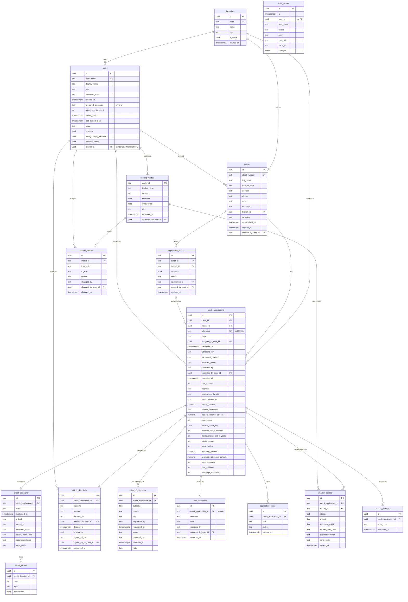

# 6. Database

PostgreSQL, created by EF Core migrations. Enums are stored as their names (text), so rows read without a lookup table. Normalised: each fact is stored once, and the history and dashboard are queries over these tables, not copies.

## Rules the database itself enforces

| Table | Rule |
|---|---|
| `scoring_models` | threshold strictly between 0 and 1; review edge, if set, between 0 and the threshold; at most one `Active` model (an `EXCLUDE` constraint, so two promotions at once cannot both win) |
| `credit_decisions`, `shadow_scores` | probability between 0 and 1; a scored row has a model and threshold, an unavailable row has an error code; a `Review` recommendation needs its review edge |
| `score_factors` | rank 1 or more, unique per decision |
| `officer_decisions` | an override must have a reason |
| `sign_off_requests` | at most one pending request per application (partial unique index); a request is reviewed exactly when it is no longer pending |
| `credit_applications` | unique reference from `application_reference_seq`; existing rows numbered in submission order; at most one open application (`Submitted` or `AwaitingSignOff`) per client (partial unique index) |
| `clients`, `users`, `branches` | PostgreSQL's `xmin` serves as the row version for optimistic concurrency on edits |
| `shadow_scores` | one score per application and model |
| all user foreign keys | `RESTRICT`: a user with history cannot be deleted |
| `users` | language `en` or `sr`; failed count not negative; existing users migrated as active, each with its own random security stamp; a branch exactly when the role is Officer or Manager |
| `branches` | unique code; `HQ` created by the migration, which moved existing officers, managers, clients and applications to it |
| `clients`, `credit_applications` | a branch is required (`RESTRICT`) |
| `audit_entries` | no foreign keys, so the log does not depend on the rows it describes; written only by the `SaveChanges` interceptor |
| application children | `CASCADE`: decisions, factors and scores belong to their application |

Indexes support the history page (submission date, applicant name), the dashboard (status and recommendation, override and outcome), the model event log (change date) and the audit log (time, entity and id, user).
