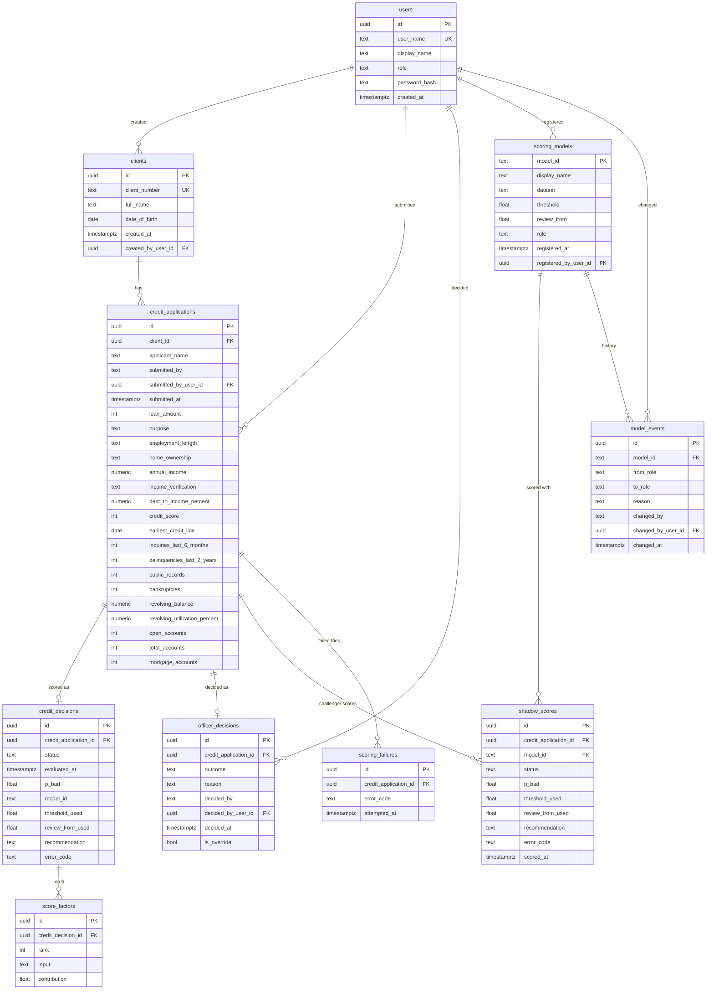

# 6. Database

PostgreSQL, created by EF Core migrations. Enums are stored as their names (text), so rows read without a lookup table. Normalised: each fact is stored once, and the history and dashboard are queries over these tables, not copies.

## Rules the database itself enforces

| Table | Rule |
|---|---|
| `scoring_models` | threshold strictly between 0 and 1; review edge, if set, between 0 and the threshold; at most one `Active` model (an `EXCLUDE` constraint, so two promotions at once cannot both win) |
| `credit_decisions`, `shadow_scores` | probability between 0 and 1; a scored row has a model and threshold, an unavailable row has an error code; a `Review` recommendation needs its review edge |
| `score_factors` | rank 1 or more, unique per decision |
| `officer_decisions` | an override must have a reason |
| `shadow_scores` | one score per application and model |
| all user foreign keys | `RESTRICT`: a user with history cannot be deleted |
| application children | `CASCADE`: decisions, factors and scores belong to their application |

Indexes support the history page (submission date, applicant name), the dashboard (status and recommendation, override and outcome) and the model event log (change date).
