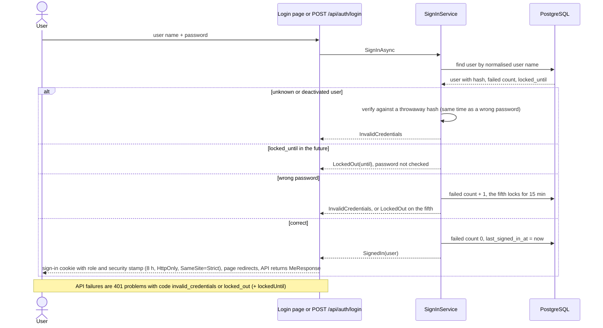
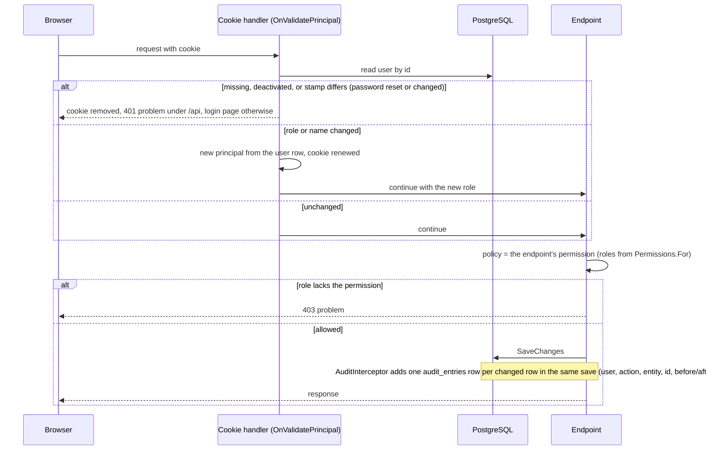
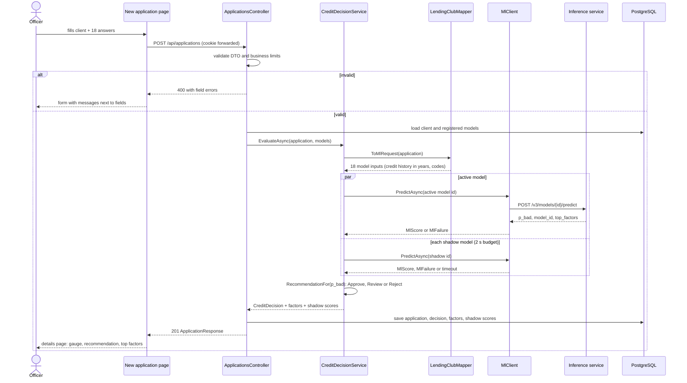
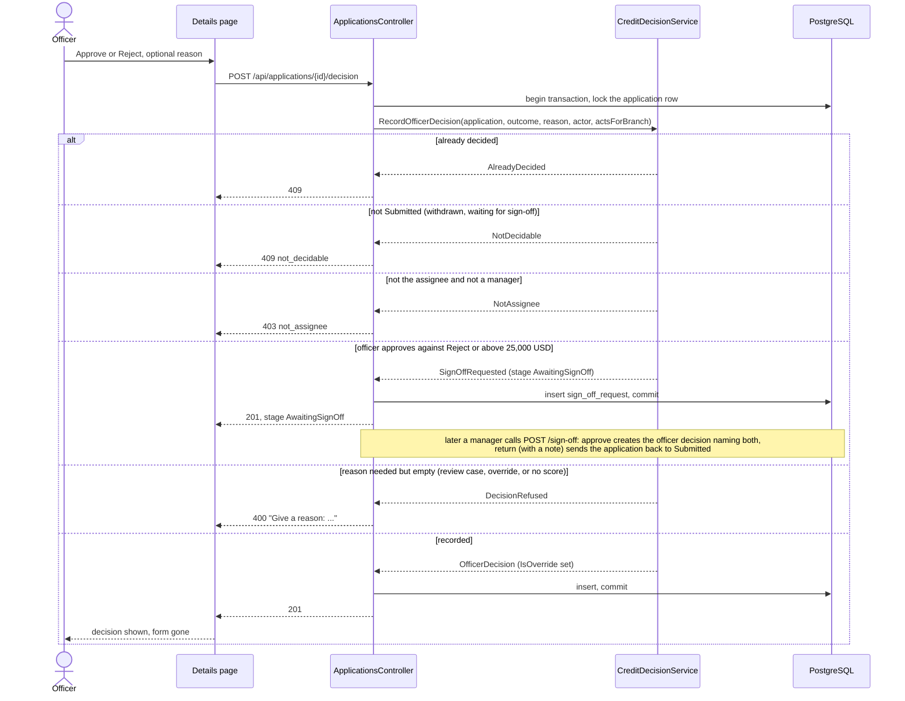
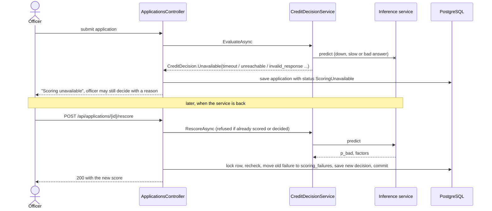
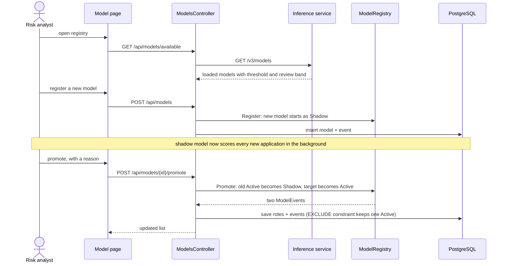
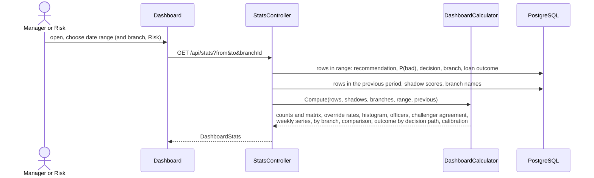
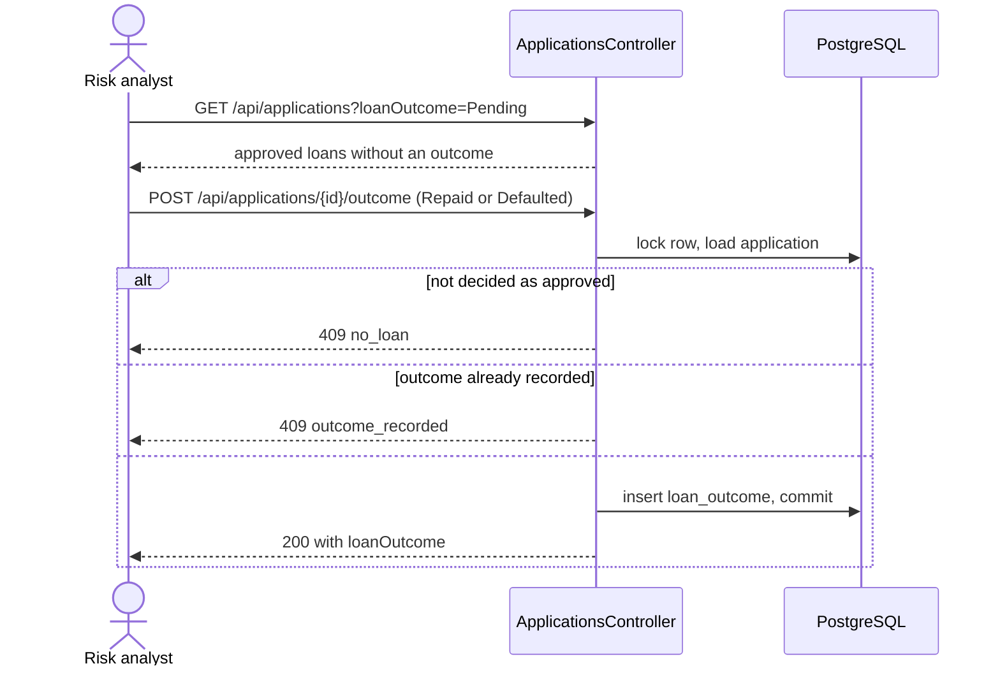

# 7. Flows

## 7.1 Sign-in

The Razor login page and `POST /api/auth/login` (React SPA) both call `SignInService`, so the lockout rule has one owner.

## 7.1a Every signed-in request

## 7.2 Submit and score an application

The main flow. The application is saved whatever happens to scoring, so no officer work is lost.

## 7.3 Officer decision and second sign-off

Only the assignee (or a manager) decides. An officer's approval against a Reject recommendation or above 25,000 USD waits for a manager.

## 7.4 Scoring outage and rescore

## 7.5 Model promotion (champion and challenger)

## 7.6 Dashboard

The controller loads plain rows for the range (and, with `from` and `to`, for the previous period of the same length); every number comes from the pure `DashboardCalculator`. A manager's rows are limited to the branch by the query filter.

## 7.7 Loan outcome

