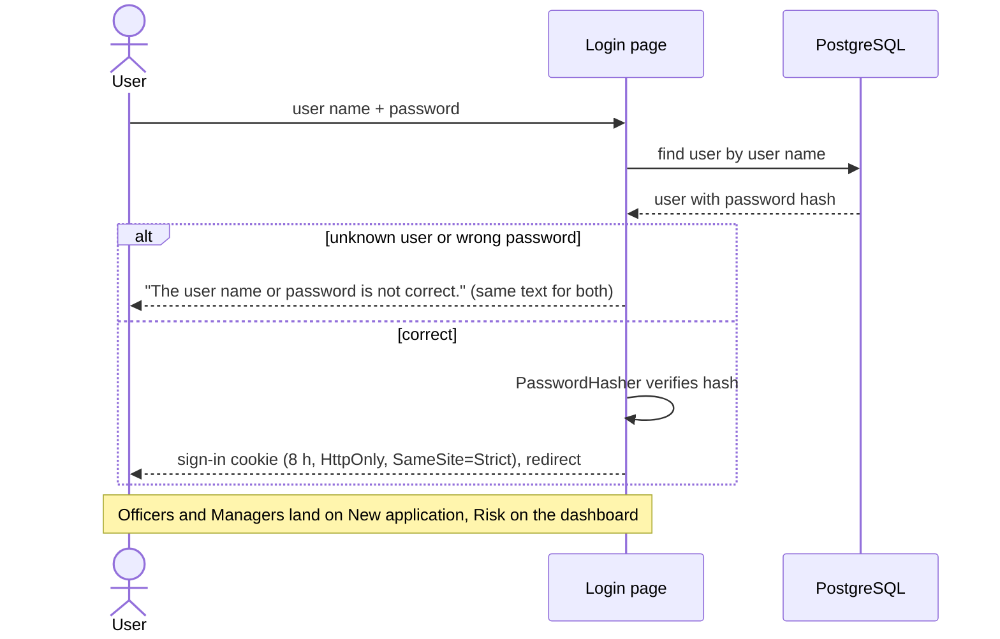
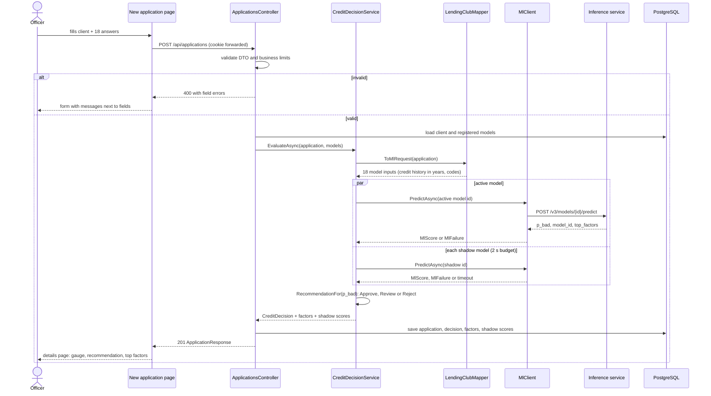
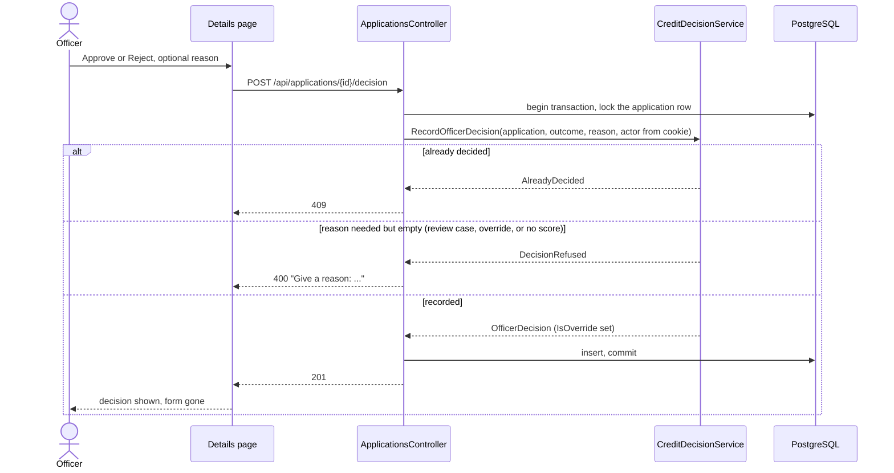
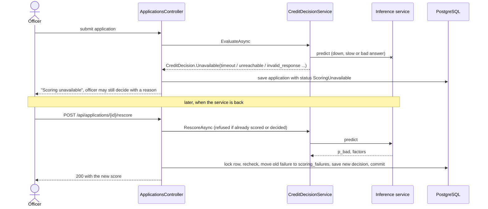
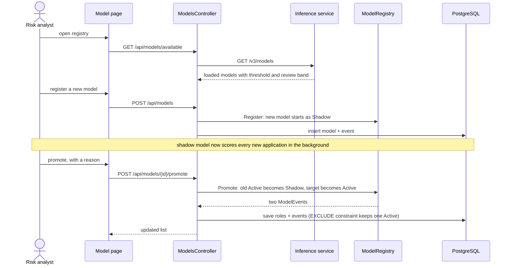
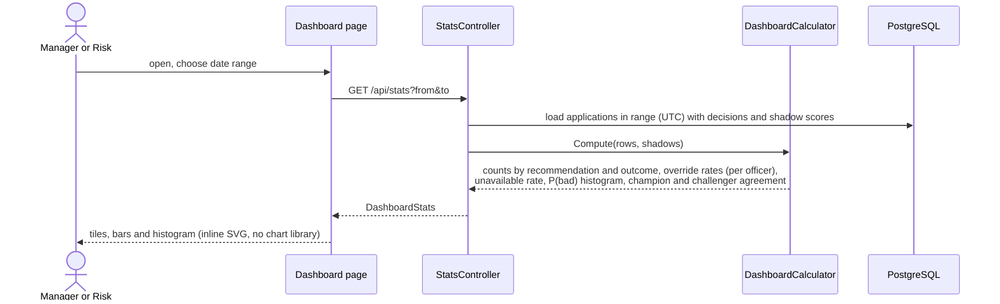

# 7. Flows

## 7.1 Sign-in

## 7.2 Submit and score an application

The main flow. The application is saved whatever happens to scoring, so no officer work is lost.

## 7.3 Officer decision

## 7.4 Scoring outage and rescore

## 7.5 Model promotion (champion and challenger)

## 7.6 Dashboard

