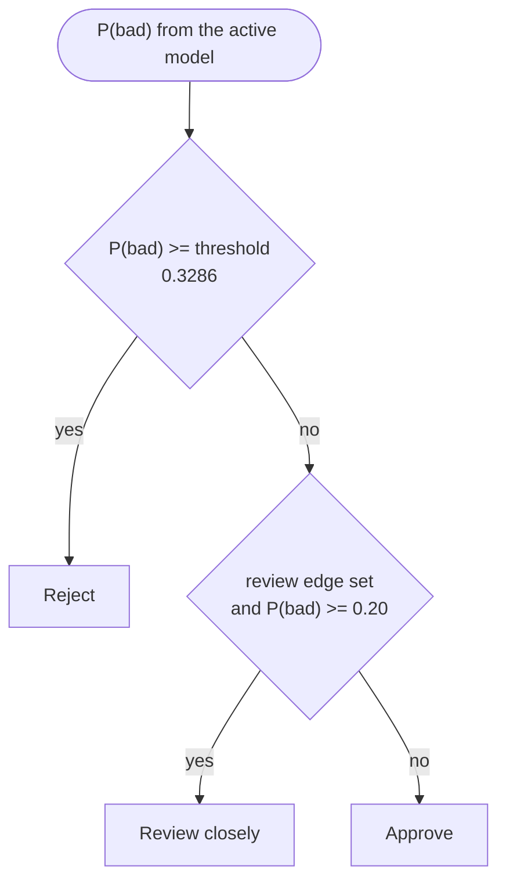
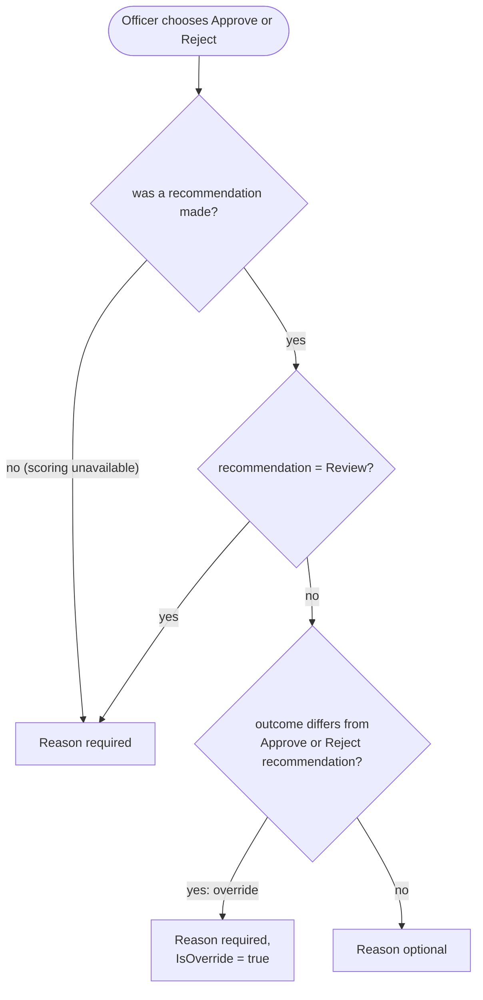
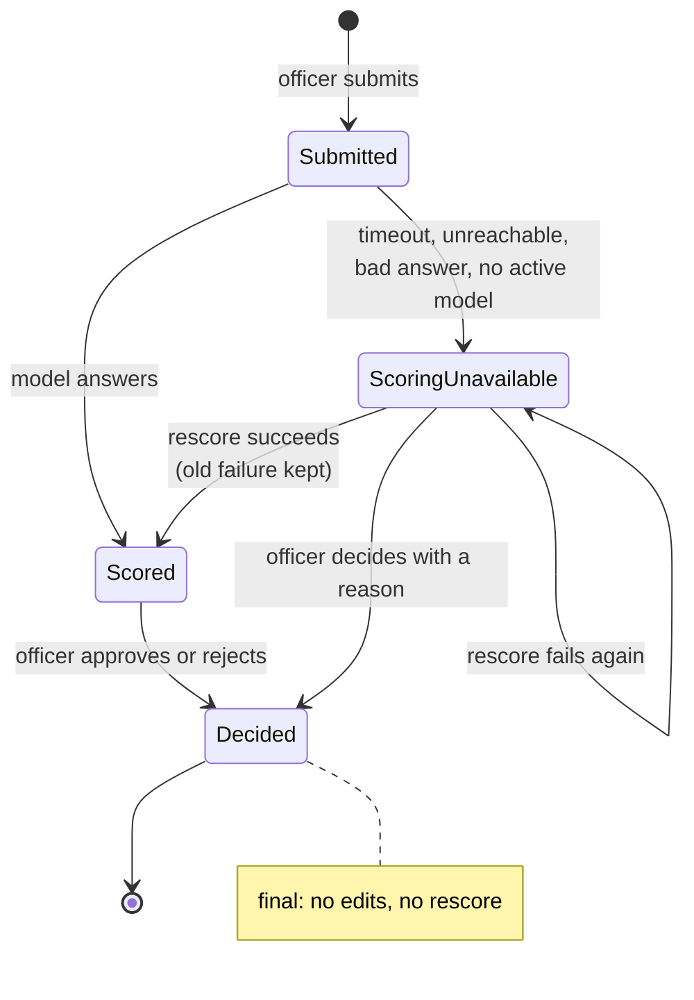
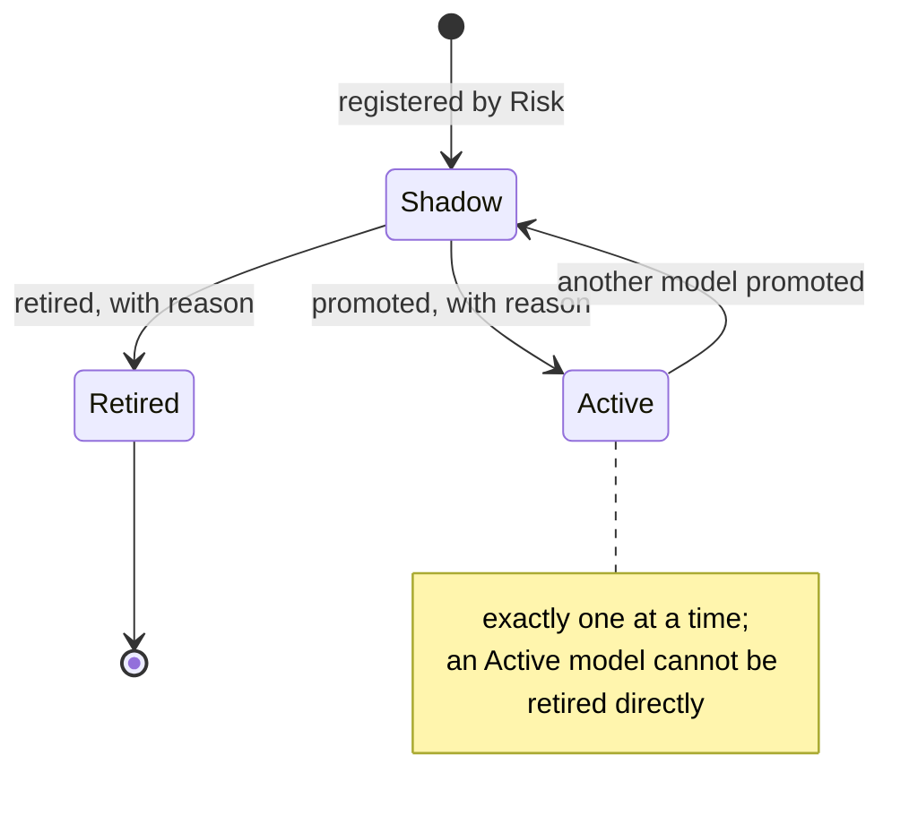

# 8. Decision logic and states

## 8.1 Recommendation rule

`ScoringModel.RecommendationFor(pBad)`. The edges belong to the registered model, so each stored decision records the threshold and review edge it was made with.

Where the numbers come from:

- **Threshold 0.3286** = 1 / (1 + 2.0431). On training loans a charged-off loan lost $4,203.69 on average and a fully paid one earned $2,057.47, so a false approval costs 2.0431 times a false rejection. Rejecting pays when P(bad) is above this point.
- **Review edge 0.20** was chosen in cross-validation (LC-03) before the test year was scored: about one application in six goes to a person, and that group holds about 30% of the bad loans.

## 8.2 When the officer must write a reason

`OfficerDecision.NeedsReason(recommendation, outcome)`. An override is only a decision against a clear recommendation; a review case has none, but still needs a reason.

## 8.3 Application life cycle

`Submitted` is not stored: an application is saved together with its first scoring result in one step.

## 8.4 Model life cycle

Every arrow writes a `ModelEvent` with who, when and why.
