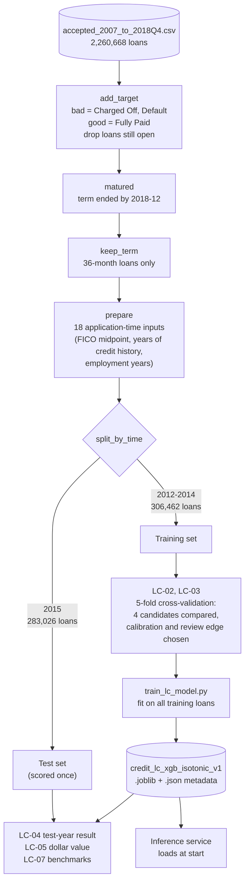
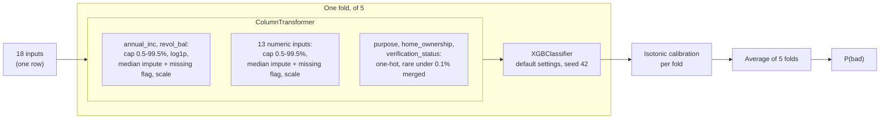
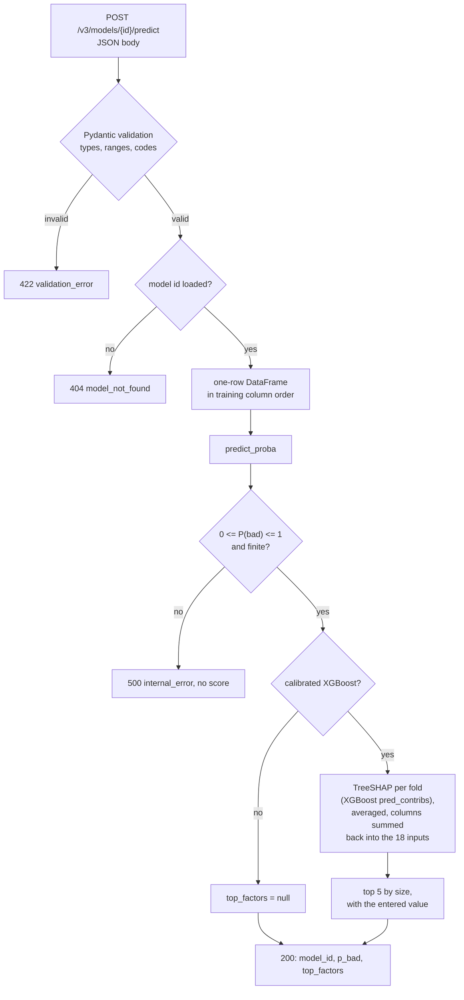
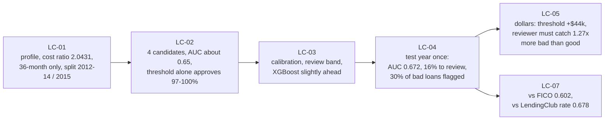

# 9. ML pipeline

## 9.1 From raw data to the served model

Run by hand, once per model version. The 2015 test year is kept apart and scored only after the model and its edges were fixed.

## 9.2 What is inside the saved model

One scikit-learn object. Preprocessing is part of it, so the service applies exactly the transforms learned on the training data.

## 9.3 Inside one prediction (inference service)

The factors are in log-odds of the model's score before calibration: they show direction and relative size, not percentage points of P(bad).

## 9.4 Experiments and what each one decided

