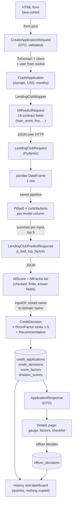
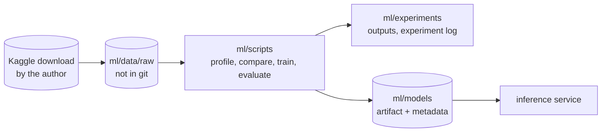

# 10. Data flow

How one application's data changes shape on its way through the system and back. Each box names the type or table that holds it.

## What crosses each boundary

| Boundary | Carries | Does not carry |
|---|---|---|
| Browser to web app | form fields, sign-in cookie | the user's name or role (taken from the cookie) |
| Web app to inference | 18 numeric and coded inputs | client name, client number, any id, the user |
| Inference to web app | `p_bad`, `model_id`, up to 5 `{feature, value, contribution}` | a recommendation (the web app decides that) |
| Web app to database | everything, normalised | computed totals (always queried) |

The inference service never sees who the applicant is: the name and client number stay in the web application.

## Training data flow (offline)

