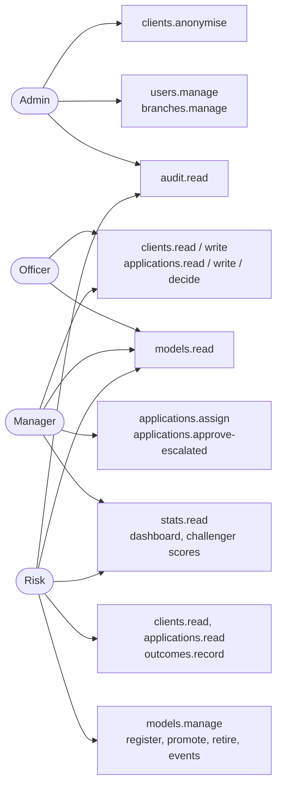

# 11. Roles and access

Four roles. Every endpoint checks one permission (`Auth/Permissions.cs`); each permission is a named policy that admits the roles holding it. No endpoint names a role. Every page and endpoint needs a signed-in user unless marked otherwise. A missing permission gives `403` from the API and the "no access" page in the UI.

| Permission | Admin | Officer | Manager | Risk |
|---|---|---|---|---|
| `users.manage` | yes | | | |
| `branches.manage` (step 3) | yes | | | |
| `audit.read` | yes | | | yes |
| `clients.read` | | yes | yes | yes |
| `clients.write` (create, edit, deactivate) | | yes | yes | |
| `clients.anonymise` | yes | | | |
| `applications.read` | | yes | yes | yes |
| `applications.write` (submit, rescore) | | yes | yes | |
| `applications.decide` | | yes | yes | |
| `applications.assign` (step 4) | | | yes | |
| `applications.approve-escalated` (step 4) | | | yes | |
| `outcomes.record` (step 5) | | | | yes |
| `stats.read` (dashboard, challenger scores) | | | yes | yes |
| `models.read` | | yes | yes | yes |
| `models.manage` | | | | yes |
| own profile, own password, own language | yes | yes | yes | yes |

**Branch scope.** Officers and managers see only clients and applications of their own branch; Risk and Admin see every branch. An EF global query filter on `clients` and `credit_applications` applies it to every query, including the dashboard; a record of another branch answers 404. The branch is a claim in the cookie, refreshed by the per-request session check.

**Ownership.** Each application has an assignee, at first its submitter. Only the assignee decides or withdraws it; a manager may act on any application of the branch and reassign it. An officer's approval against a Reject recommendation or above 25,000 USD needs a manager's second sign-off.

Separation of duties: Admin manages people and reads the audit log but sees no clients or applications; Risk manages models and records outcomes but cannot decide; officers do not see challenger scores, because two different numbers for one applicant invite picking the one that suits.

## Session

- Cookie authentication, no extra identity tables: one `users` table, passwords hashed with ASP.NET's `PasswordHasher`.
- Cookie `HttpOnly`, `SameSite=Strict`, 8 hours, sliding. Set by the Razor login page or by `POST /api/auth/login` (React SPA); `GET /api/auth/me` returns the user, role, permissions, preferred language and whether the password must be changed.
- Five wrong passwords in a row lock the account for 15 minutes (`SignInService`, shared by both logins). A deactivated user gets the same answer as a wrong password.
- Every request re-reads the user. The cookie carries a security stamp; deactivation, an Admin password reset and an own password change replace the stamp, so older cookies stop working at once. A changed role or name is picked up on the next request.
- Admins cannot change their own role or deactivate themselves.
- Under `/api`, a missing sign-in is a 401 problem and a missing permission a 403 problem, each with a `code`; pages outside `/api` redirect to the login or "no access" page.
- CSRF: `SameSite=Strict` plus JSON-only writes; no anti-forgery token.
- The Razor pages forward the user's cookie to the API, so the API applies the same permissions to UI and direct calls. Razor folders require the matching read permission, so Admin sees "no access" there; the SPA is Admin's interface.
- Every write is recorded in `audit_entries` by one `SaveChanges` interceptor (who, when, what, before and after); `GET /api/audit` lists it for Admin and Risk.
- Demo users (one per role, including Admin) are seeded in Development only.
