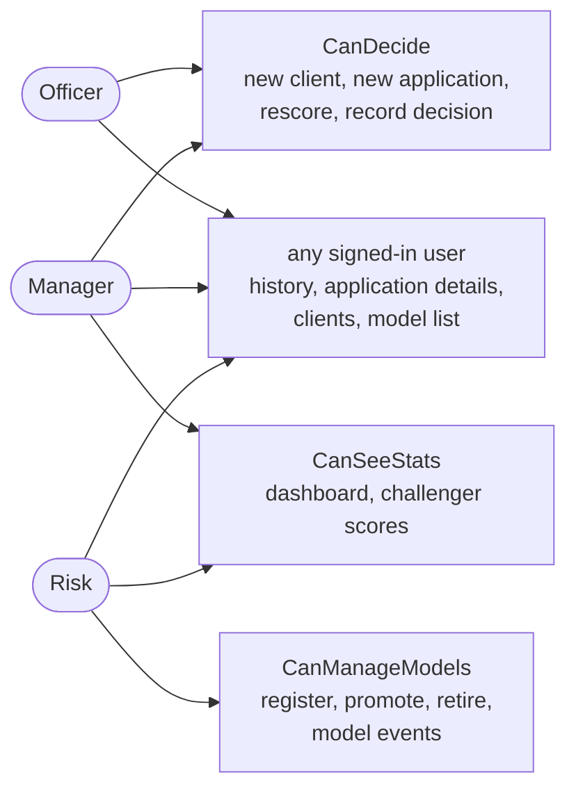

# 11. Roles and access

Three roles, checked on the server by named policies (`Auth/Policies.cs`). Every page and endpoint needs a signed-in user unless marked otherwise. A missing right gives `403` from the API and the "no access" page in the UI.

| Action | Officer | Manager | Risk |
|---|---|---|---|
| Search history, open an application, view clients | yes | yes | yes |
| Create a client, submit an application | yes | yes | |
| Rescore after an outage, record the final decision | yes | yes | |
| See challenger (shadow) scores on an application | | yes | yes |
| Dashboard | | yes | yes |
| Register, promote or retire a model, read model events | | | yes |

Why officers do not see challenger scores: two different numbers for one applicant invite picking the one that suits, and the officer should weigh one recommendation against the facts.

## Session

- Cookie authentication, no extra identity tables: one `users` table, passwords hashed with ASP.NET's `PasswordHasher`.
- Cookie `HttpOnly`, `SameSite=Strict`, 8 hours, sliding.
- The Razor pages forward the user's cookie to the API, so the API applies the same policies to UI and direct calls.
- Demo users are seeded in Development only. There is no user management screen yet.
