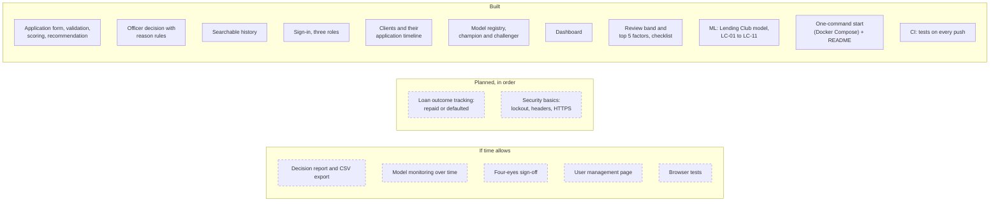
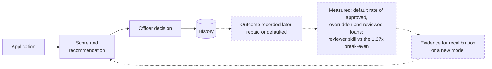

# 12. Status and roadmap

Where the system is on 2026-11-09 and what is planned next. Solid boxes are built and tested; dashed ones are planned.

## What changes when outcome tracking lands

The archive becomes a feedback loop, which is the supervisor's original brief: every stored decision can later be compared with what the borrower actually did.

## Test counts (last run)

| Part | Tests |
|---|---|
| Backend (xUnit, with PostgreSQL) | 454 |
| ML (pytest) | 113 |
| Inference (pytest) | 79 |
